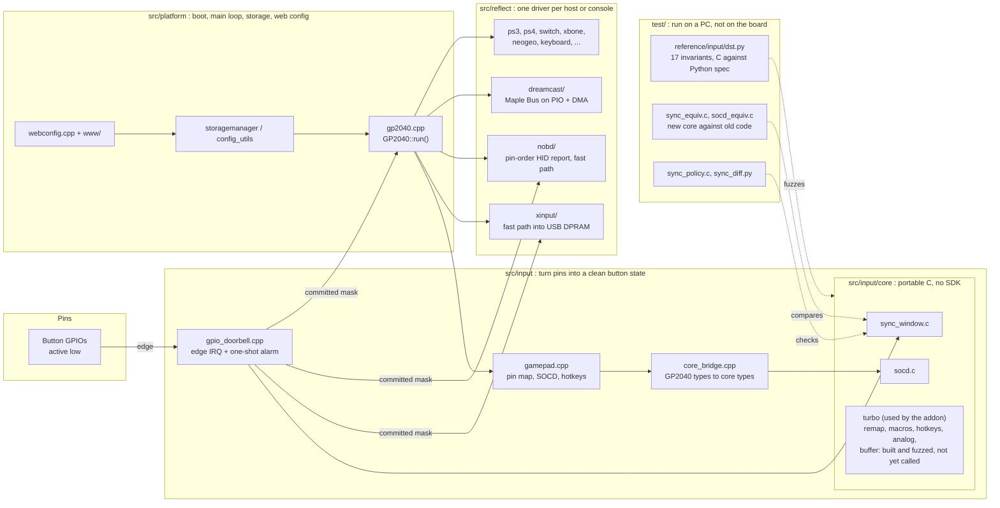
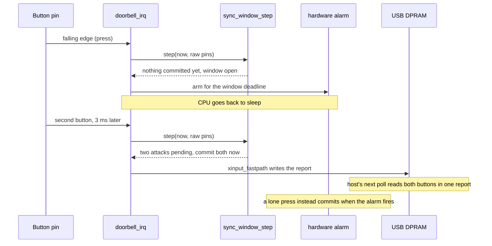

# NOBD firmware floorplan

A map of this repository for someone opening it cold. It covers what the fork adds to GP2040-CE, where
that code lives, and the path one button press takes from the pin to the wire.

Written against `main` at `35a3aa8b` (release `v0.7.12-nobd-29`, 2026-11-16). Every statement points at a
file you can open. Line numbers are for that commit and will drift; function names will not.

## 1. What this is

[GP2040-CE](https://github.com/OpenStickCommunity/GP2040-CE) is open firmware for RP2040 fight stick
boards. This fork is 209 commits ahead of it and adds three things:

1. **The NOBD sync window.** A stick reports at 1000 Hz and an old arcade game reads at 60. Two buttons
   pressed a few milliseconds apart can land on either side of the game's read, so a two-button input
   arrives as one button, then the other. The window holds a new press for a few milliseconds and commits
   every press that arrived in that time together. See [WHY-NOBD.md](WHY-NOBD.md).
2. **An edge-driven input path.** Upstream polls the pins in the main loop. Here the pins raise an
   interrupt and the interrupt runs the window. In XInput mode with a plain button mapping it also writes
   the USB report, and the CPU sleeps in between. Section 4 lists when that applies.
3. **A native Dreamcast output.** The board speaks Maple Bus directly to a console, including a VMU. See
   [DREAMCAST.md](DREAMCAST.md).

The source tree was also reorganised around one idea: inputs are **processed** once, then **reflected** to
whichever console or host is plugged in.

## 2. The floorplan

Solid arrows are calls or data at run time. Dashed arrows are tests that compile the same C for a PC.

## 3. The rooms

| Room | Path | What it holds |
|---|---|---|
| Input core | `src/input/core/` | Input stages as portable C with no Pico SDK includes, so the same files build for the RP2040 and for a PC. About 880 lines of `.c`. The shipping firmware calls three of them: `sync_window`, `socd` and `turbo`. The others (`remap`, `macros`, `hotkeys`, `analog`, `buffer`, `input_pipeline`) are built and fuzzed but not wired in yet; they come from the next hardware design. |
| Doorbell | `src/input/gpio_doorbell.cpp` | The only owner of the GPIO bank interrupt. `doorbell_irq` acknowledges every pending button edge in one pass, `stepSync` runs the window once, and a hardware alarm (`sync_alarm_irq`) fires at the window's deadline. All of it is pinned in RAM so the edge path never waits on flash. 451 lines. |
| Bridge | `src/input/core_bridge.cpp` | The one place GP2040's types become the core's `buttons_t` and back. `syncGpio` and `cleanDpad` live here. |
| Main loop | `src/platform/gp2040.cpp` | `GP2040::setup()` and `GP2040::run()`. Outside Dreamcast mode the loop sleeps on `__wfi()` and wakes on a button edge, a 1 ms tick or USB. It still runs addons, display, hotkeys and saves. |
| Reflectors | `src/reflect/` | One driver per output. `xinput/` and `nobd/` each register a fast path the interrupt calls directly; every other driver builds its report in the loop. `nobd/` is a standard HID gamepad whose button order follows pin order, with the pin runs hard-coded for the RP2040 Advanced Breakout Board. `dreamcast/` is the Maple Bus transport (`maple.pio`, `maple_bus.cpp`), the controller (`DreamcastDriver.cpp`) and the VMU (`DreamcastVMU.cpp`). |
| Measurement | `src/input/latency_probe.*`, `src/input/selftest.*` | Compiled out of release builds. The probe timestamps edge, report staged and report on the wire from the chip's own 1 µs timer. The self test drives the board's own button pins on a schedule so the whole path can be checked with no hands on it. |
| Web config | `www/`, `src/platform/webconfig.cpp` | The React settings page served by the board, with the NOBD settings and the VMU manager added. |
| Proof | `test/` | Described in section 5. |
| Release | `.github/workflows/release.yml` | Builds a UF2 for four boards (RP2040 Advanced Breakout Board, Pico, Pico W, Waveshare Zero) and refuses a tag that is not on `main`. Dreamcast output needs Maple pins, which the Advanced Breakout Board and Waveshare Zero configs define. |

## 4. One press, pin to wire

This is XInput mode with the sync window on and the default settings: eager commit at two attack buttons,
pulse width preserved, directions outside the window. The window length is a setting. A fresh Pico or
Pico W starts at 5 ms; the Advanced Breakout Board and Waveshare Zero start with it off
(`configs/*/BoardConfig.h`).

Where each step is:

1. `doorbell_irq` in `src/input/gpio_doorbell.cpp` takes the edge and calls `stepSync`.
2. `stepSync` reads the pins once, calls `sync_window_step` (`src/input/core/sync_window.c`) inside a
   short critical section, and arms the alarm for whatever the window still owes.
3. With two attack buttons pending the window commits at once (`commit_at` in `sync_window.c`) and stays
   open to the original deadline so a third button can still join. A lone press commits when the alarm
   fires (`sync_alarm_irq`).
4. When the committed state changes, the edge or alarm interrupt calls the registered fast path. For XInput
   that is `xinput_fastpath` in `src/reflect/xinput/XInputDriver.cpp`, which formats the mask and writes it
   into the endpoint buffer with two 16-bit stores, so the USB hardware can never read half of a chord.
5. The main loop wakes afterwards, reads the same committed mask through `GpioDoorbell::committed()`, and
   updates everything that is not latency critical.

The fast path is not always armed. Each loop pass, `XInputDriver.cpp` checks that the straight pin map
would produce exactly the report the full path produced, and arms the interrupt only inside that envelope:
a gamepad device type, no four-way mode, a stateless SOCD mode, and no addon having changed the report.
Turbo, macros, last-win SOCD and the other console modes all fall back to the loop building the report. The
window itself still runs in the interrupt in those cases.

With the window off, step 2 commits immediately and the report is staged on the edge. In Dreamcast mode the
loop samples the pins itself, runs its own instance of the window (`syncGpioGetAll`), and the Maple
interrupt answers the console's poll from that state.

The rules the window follows are written at the top of `src/input/core/sync_window.h`. The short version:
by default directions stay out of the window (`nobdSyncPolicy` in `src/platform/gp2040.cpp`), a button's
release is delayed by the same amount its press was so the held length is unchanged, and a chord commits as
soon as it is complete. The defaults are set in `src/platform/config_utils.cpp`; some comments in the
header still describe the earlier defaults.

## 5. How it is checked

The first three rows need no board. The core is plain C, so it is compiled for a PC (the parity tiers need
`zig cc` on the path and are skipped without it) and run against references.

| Check | File | What it compares |
|---|---|---|
| Deterministic simulation | `test/reference/input/dst.py` | 17 invariants in 15 tiers. Six tiers fuzz the Python specification on its own; nine drive the C and the Python with the same inputs and require identical output step for step. |
| Equivalence with the old code | `test/sync_equiv.c`, `test/socd_equiv.c` | The new core against the routines it replaced, transcribed from the earlier firmware. This catches a mistake that the C and its own specification would share. |
| Policy | `test/sync_policy.c`, `test/sync_diff.py` | The optional behaviours: which bits may be delayed, what counts as a chord, eager commit, and preserved pulse width. |
| On the board | `src/input/selftest.cpp`, `tools/selftest/selftest.py` | A special build presses its own buttons on a schedule and a PC script checks every press and release arrived in order with the right width. |
| Latency | `docs/latency-testing/` | How to build the measurement image and read the edge-to-wire numbers. |

## 6. Where to start reading

- To understand the idea: `docs/WHY-NOBD.md`, then the comment block in `src/input/core/sync_window.h`.
- To follow the hot path: `doorbell_irq` and `stepSync` in `src/input/gpio_doorbell.cpp`, then
  `xinput_fastpath` in `src/reflect/xinput/XInputDriver.cpp`.
- To change behaviour safely: edit a stage in `src/input/core/` together with its Python twin in
  `test/reference/input/`, then run `python dst.py` in that folder.
- For the Dreamcast side: `docs/DREAMCAST.md`, then `src/reflect/dreamcast/maple_bus.cpp`.

## 7. What is not in this map

Everything inherited from upstream GP2040-CE that the fork did not change in substance: the addons under
`src/addons/`, the display and LED code under `src/ui/`, the USB host code, and the board configurations
under `configs/`. Upstream's own documentation covers those.
